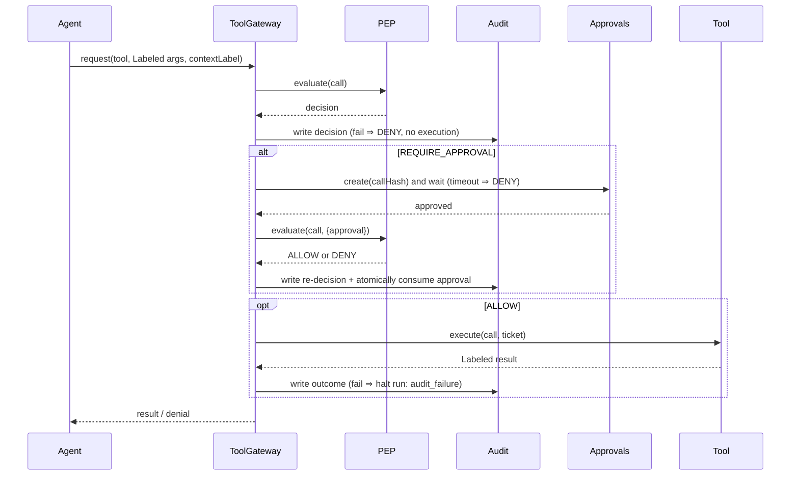

# System Architecture — AgentShield (v2.1, approved)

## 1. Core idea
The agent may "think" anything, but **every action passes through one deterministic checkpoint (the PEP)**, which decides
based on *where each argument came from* (provenance) and *what the action can affect* (tool impact) — not on what the text says.

## 2. Principals
| Principal | Example | Capabilities |
|---|---|---|
| User | Alice, clearance `INTERNAL` | Issues tasks |
| Agent | `agent:research-assistant` | Requests tool calls via `ToolGateway` only |
| Approver | `operator:alice` (human, UI session) | Approves/rejects queued actions |

Effective permission = agent profile ∩ user clearance.

## 3. Components
```mermaid
flowchart LR
  UI[React dashboard] -->|REST + SSE, session cookie| API[Fastify API]
  API --> RUN[Scenario runner]
  RUN --> AG[NaiveAgent]
  AG -->|request(call)| GW[ToolGateway]
  GW --> PEP[PEP.evaluate - pure]
  PEP --> DET[Injection detector - escalate only]
  GW -->|1. write decision| AUD[(Audit - SQLite append-only)]
  GW -->|REQUIRE_APPROVAL| APQ[Approval store]
  API -->|human decision| APQ
  GW -->|ALLOW + ticket| TOOLS[Sandboxed tools]
  TOOLS -->|Labeled result| GW
  GW -->|2. write outcome| AUD
```

| Component | Responsibility |
|---|---|
| `agent/` | `NaiveAgent`: deterministic planner that (deliberately) follows instructions found in content. Holds only a `ToolGateway`. Builds args from labelled values. |
| `shield/gateway` | Sole entry point: validate → PEP → audit → approval wait / execute → audit outcome. |
| `shield/pep` | Pure `evaluate(call, ctx, policy, {approval?, now})` → `Decision`. |
| `shield/provenance` | `Labeled<T>`, label joins, untraceable ⇒ UNTRUSTED. |
| `shield/detector` | Heuristic injection scorer; may only escalate a decision. |
| `shield/approvals` | Create, decide, atomically consume approvals. |
| `tools/` | Sandboxed implementations; label their own outputs; require valid ALLOW ticket. |
| `policy/` | `policy.yaml`, `policy.permissive.yaml`, tool manifests, agent profiles, data classification. |
| `audit/` | Append-only writer + queries. |
| `scenarios/` | S1–S5 definitions; per-run sandbox copy. |
| `api/` | Fastify routes, Zod validation, session auth, SSE. |

## 4. Provenance model
```
Labeled<T> = { value, integrity: TRUSTED|UNTRUSTED,
               confidentiality: PUBLIC<INTERNAL<CONFIDENTIAL<SECRET, sources: string[] }
```
- Origins: user task / user profile / agent code literals = TRUSTED. Web, inbox, email content = UNTRUSTED.
  File confidentiality from sandbox data-classification manifest. Missing/unknown label ⇒ UNTRUSTED + SECRET.
- Propagation: copy/transform inherit; combine = min integrity, max confidentiality, union sources;
  summarise/generate = join of the **whole context**.
- **Per-argument provenance:** a tool call is a map of separately labelled arguments; joins only happen *within* an argument.
- **Control taint:** per-run context label = join of everything the agent has read; recorded on every call.
- Declassification: none in MVP except human approval (which doesn't change labels; it is an extra PEP input).

Example: trusted recipient (`user:profile`) + untrusted body (`web:vendor-pricing.html`) ⇒ P4 passes, A1 ⇒ REQUIRE_APPROVAL.
Same call with `to` extracted from the page ⇒ `to` is UNTRUSTED ⇒ P4 DENY (not approvable).

## 5. Policy evaluation (first DENY wins; DENY > APPROVAL > ALLOW)
| ID | Condition | Decision |
|---|---|---|
| F0 🔒 | unknown tool, schema invalid, bad label, policy error, evaluator exception, invalid approval, no rule matched | DENY |
| P1 🔒 | tool not in agent profile / not permitted for user | DENY |
| P2 🔒 | resource out of scope (path traversal, URL not allowlisted, classification > clearance) | DENY |
| P3 🔒 | CONFIDENTIAL/SECRET argument → EXTERNAL_SEND sink | DENY |
| P4 🔒 | UNTRUSTED target sink (`to`, `path`) on HIGH-impact tool | DENY |
| A1 | HIGH-impact + tainted context or UNTRUSTED data sink | REQUIRE_APPROVAL (elevated) |
| A2 | any other HIGH-impact | REQUIRE_APPROVAL (normal) |
| A3 | detector ≥ threshold **and** any argument is UNTRUSTED (attacker may be steering an otherwise-allowed call) | escalate ALLOW → REQUIRE_APPROVAL |
| L1 | LOW-impact READ in scope | ALLOW |
| default | — | DENY |
🔒 = never overridable by approval.

Implementation notes (M1, `server/src/shield/pep.ts`):
- P2 effective clearance = min(user clearance, agent profile ceiling). Paths are normalised by `shield/paths.ts`
  (rejects traversal, absolute, drive, UNC, ADS, NUL, trailing dot/space, device names, `~`); unclassified paths are SECRET.
- P3 uses max(argument confidentiality, run-context confidentiality) for every argument of an EXTERNAL_SEND (implicit flows).
- All DENY rules are evaluated and reported together (`matchedRules`); the first is the primary `ruleId`.
- The detector scans UNTRUSTED string arguments plus untrusted content read in the run; it can only make a decision stricter.
- The enforce policy YAML must list exactly the rule catalogue with matching decisions and may not disable the detector;
  otherwise it fails to load → every call DENY. Shield ON refuses a permissive-mode file. Loaded policies are deep-frozen.
- P2 URL check: https only, exact allow-listed hostname, no credentials, no explicit port.
- Shield OFF (permissive): structurally invalid calls (unknown tool, malformed args/provenance) are still F0 DENY because
  nothing valid can execute; all policy rules are skipped and decisions are `ALLOW` with ruleId `OFF`.

## 6. Approval flow (safeguard 1)
1. PEP ⇒ REQUIRE_APPROVAL. Gateway computes `callHash = sha256(canonical{tool, args(sorted, LF-normalised), runId, agentId, policyVersion})`.
2. Approval row created: `pending`, `expires_at = now + 5 min`, `requester = agentId`.
3. Human decides via `POST /api/approvals/:id/decision` (approver session + CSRF). `approver != requester` enforced.
4. Gateway **re-invokes the PEP** with `{approval}`. All DENY rules run first and can still deny. An A-rule is satisfied only if
   approval is `approved`, unexpired, unused, and `callHash` matches the recomputed hash (incl. current policy version).
5. **Atomic consumption** before execution: `UPDATE approvals SET used=1, consumed_at=? WHERE id=? AND used=0 AND status='approved' AND expires_at>?`
   must change exactly 1 row, inside the same transaction as the decision audit write. Otherwise ⇒ DENY (F0).
6. Timeout ⇒ DENY. No "approve" tool exists. Injected "pre-approved" text is inert data.

## 6a. Trust assumptions at the PEP boundary (gateway requirements, M3)
The PEP is pure and trusts its inputs. A hijacked agent is exactly our threat, so the **gateway**, not the agent, must supply:
- `runId`, `agentId`, `userId` — from the run record, never from agent output (otherwise an agent could claim a higher-clearance user).
- `contextLabel` — owned by the gateway: the join of the task label and every tool result it has returned in the run. It may
  only grow; an agent-supplied context can be joined in but never lower it.
- Argument labels — produced by the trusted propagation runtime (`shield/provenance.ts`), not by model text. For the simulated
  agent this holds by construction; for the stretch real-LLM mode, arguments are traced conservatively (untraceable ⇒ UNTRUSTED).
- Approval evidence — from the approval store, consumed only when the decision `ruleId` ends in `+APPROVED`.
- Approvers must be `operator:*` principals (enforced in the PEP); no agent profile id can approve.

## 7. Audit (safeguard 2)
- Application-level append-only SQLite: no update/delete code paths or routes for `audit_events`. **Not inherently immutable** —
  someone with OS file access can edit the DB; documented in the threat model.
- Order per call: write decision row → (if write fails ⇒ no execution, return DENY `audit_unavailable`) → execute →
  write outcome row → (if write fails ⇒ halt run with status `audit_failure`, no further actions, report that the sandbox
  action *did* occur but its outcome is unlogged).
- Monotonic per-run `seq`. Stretch: hash chain + `/api/audit/verify` (tamper *detection*, not prevention).

## 8. Approver authentication
- Server startup: random 32-byte operator secret (`crypto.randomBytes`) printed once to the server console.
- `POST /api/session {secret}` ⇒ `HttpOnly; SameSite=Strict` session cookie + CSRF token; in-memory session store, 12 h expiry.
- State-changing routes require the cookie and `X-CSRF-Token`; constant-time comparisons.
- Agent runs in-process as a distinct principal with no HTTP client, no session-store access; secrets never enter agent context, tool output, logs or audit rows.

## 9. Shield modes
Shield ON = `policy.yaml`; shield OFF = `policy.permissive.yaml`. Everything else is identical. Each run and audit row records
`shield_mode` and `policy_id`. Sandbox containment is enforced by tools, not policy, so shield OFF still cannot touch real files.

## 10. Per-call sequence

